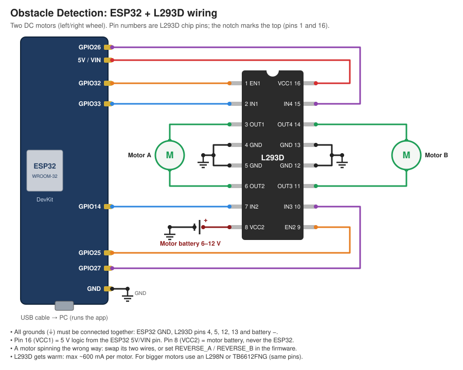

# Obstacle Detection: Pilot Assist

Drives straight ahead and watches the path through a camera (no preview window; the app picks
the first camera index that works). It looks for **people, cars, trucks, buses, bikes and
animals** (cow, horse, dog...) and estimates how far away they are from the box size:
big box = close, small box = far. Two **ultrasonic sensors** on the ESP32 check the close range.

- Obstacle within the **slow-down distance**: speed drops to the **slow speed limit**.
- Obstacle within the **stop distance**, or either ultrasonic sensor under its limit: speed 0.
  The vehicle will not start while something is there, and moves on by itself once it is gone.
- Camera lost, ESP32 unplugged or no ultrasonic data: stops, and waits for **Start** again.

All of these limits are set in the GUI (**Limits** panel) and apply immediately.

## Quick start (Windows)
1. Install [Python 3.10+](https://www.python.org/downloads/) and tick **"Add python.exe to PATH"** during setup.
2. Download this repo (**Code → Download ZIP**) and unzip it.
3. Double-click:

| File | What it does |
|---|---|
| `install.bat` | Creates a `venv` folder, installs the packages and offers to install YOLO (optional, ~2 GB) |
| `run.bat` | Starts the app (runs `install.bat` first if needed)|
| `run_sim.bat` | Starts in simulation mode: no camera needed, set a pretend obstacle distance |
| `stop.bat` | Closes the running app |

Command-line options can be passed through, e.g. `run.bat --source 1` to force a camera index.

## Manual setup (any OS)
```bash
pip install -r requirements.txt          # Linux also needs: sudo apt install python3-tk
pip install -r requirements-yolo.txt     # optional, much better detection
python app.py --sim                 # no camera needed: set the obstacle distance in the GUI
python app.py                       # first working camera
python app.py --source 1 --port COM3
```
Keys: **Enter** = start, **Space** = stop.

## How it decides
```
STOPPED ──Start──▶ CRUISING ──camera obstacle within slow distance──▶ SLOWING (slow speed limit)
CRUISING / SLOWING ──camera within stop distance, or ultrasonic under limit──▶ BLOCKED (speed 0)
BLOCKED / SLOWING ──obstacle gone for 1 s──▶ back up to speed by itself
any state ──Stop, camera lost, ESP32 / ultrasonic lost──▶ STOPPED ──Start──▶ moving again
```
Only objects inside the **path zone** (the middle 40% of the image) count. Distance is
`real height × focal / box height`, using a typical height per class (person 1.7 m, car 1.5 m,
cow 1.4 m...; table in `detector.py`). It is a rough estimate: calibrate `--focal` for your camera
(how-to at the top of `detector.py`). Objects cut off by the frame edge look farther than they
are, which is why the ultrasonic sensors cover the close range.

## ESP32 + L293D (driving real motors)
The PC does the camera work and decides the speed. It sends that speed to an **ESP32** over the USB
cable, and the ESP32 drives two DC motors through an **L293D**.



| ESP32 pin | L293D pin | Purpose |
|---|---|---|
| GPIO25 | 1 (EN1) | Motor A speed (PWM) |
| GPIO26 | 2 (IN1) | Motor A direction |
| GPIO27 | 7 (IN2) | Motor A direction |
| GPIO14 | 9 (EN2) | Motor B speed (PWM) |
| GPIO32 | 10 (IN3) | Motor B direction |
| GPIO33 | 15 (IN4) | Motor B direction |
| 5V / VIN | 16 (VCC1) | L293D logic power |
| GND | 4, 5, 12, 13 | Ground (also battery −) |
| | 8 (VCC2) | **Motor battery +** (6–12 V) |
| | 3 + 6 (OUT1, OUT2) | Motor A |
| | 11 + 14 (OUT3, OUT4) | Motor B |

| ESP32 pin | HC-SR04 | Purpose |
|---|---|---|
| GPIO5 / GPIO18 | left TRIG / ECHO | Left ultrasonic sensor (1) |
| GPIO19 / GPIO21 | right TRIG / ECHO | Right ultrasonic sensor (2) |
| 5V / GND | VCC / GND | Sensor power |
| GPIO23 / GND | active buzzer + / - | Beeps under the hard stop distance (15 cm default, set in GUI) |

| ESP32 pin | GPS module (NEO-6M etc.) | Purpose |
|---|---|---|
| GPIO16 (RX2) | TX | GPS data in, 9600 baud |
| GPIO17 (TX2) | RX | optional |
| 3V3 or 5V / GND | VCC / GND | per your module |

The HC-SR04 ECHO pin outputs 5 V: put a divider (1 kΩ from ECHO, 2 kΩ to GND) in front of the
ESP32 pin. (`docs/wiring.svg` shows the motor side only.)

**Steps**
1. Wire it as shown above. Connect all the grounds together.
2. Flash the firmware with the Arduino IDE. Install the **esp32 by Espressif** board package
   (Boards Manager), open `firmware/obstacle_esp32/obstacle_esp32.ino`, select **ESP32 Dev Module**
   and the right COM port, then click Upload.
3. *(Optional)* Test without the app: open the Serial Monitor at 115200 baud and type `S0.5`.
   Both motors should spin. They stop half a second later, because the safety watchdog expects
   commands to keep arriving.
4. Close the Serial Monitor, then start the app. In the **ESP32 (USB)** panel, pick the COM port and
   click **Connect**. You can also start it with `run.bat --port COM3`.

**Protocol:** one line per message at 115200 baud. App to ESP32: `S<speed>`, speed `0.00` to `1.00`,
repeated every 0.2 s, and `C<hard stop cm>,<min duty>,<reverse A 0/1>,<reverse B 0/1>` (GUI
settings) every 1 s. ESP32 to app: `U<left cm>,<right cm>` every 0.1 s (`999` = no echo), plus the GPS's NMEA `$..RMC` / `$..GGA`
sentences passed through unchanged (shown in the Sensors panel; GPS does not affect driving). As a
backstop the ESP32 refuses to drive while either sensor reads under `HARD_STOP_CM` (15 cm),
whatever the app says. If nothing arrives for 0.5 s (app closed or crashed, cable
pulled out), the ESP32 brakes the motors. If the ESP32 disconnects, the app shows **STOPPED**.

**Tuning** (Settings panel in the GUI): if the motors hum but don't turn at low speed, raise
**ESP32 motor min PWM**. If a motor runs backwards, tick **Reverse motor A / B** (or swap that motor's
two wires). **ESP32 buzzer + hard stop under** sets the buzzer / backstop distance.

## Files
- `controller.py`: the speed logic (no GUI); tests are in `tests/`
- `detector.py`: finds obstacles and estimates distance (YOLO if installed, otherwise a crude edge-based fallback)
- `vehicle.py`: `Esp32Vehicle` sends speeds to the ESP32
- `esp32_link.py`: USB serial connection, ultrasonic readings, and the ESP32 panel in the GUI
- `firmware/obstacle_esp32/`: the ESP32 sketch (Arduino)
- `app.py`: Tkinter GUI

> ⚠️ **Safety:** a single camera can only guess distance, and ultrasonic sensors miss soft or
> angled surfaces. On anything that really moves, add a hardware emergency stop. Do not rely on this
> software alone. Your motor controller should also stop by itself if it stops receiving speed
> commands (a watchdog), in case the app crashes or is force-closed.

## Tests
```bash
pip install pytest && python -m pytest tests
```
